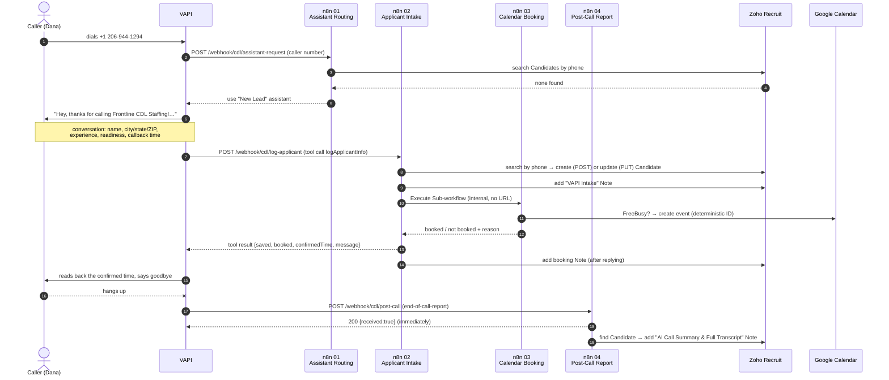

# U1 — One call, end to end

> **Goal:** be able to draw the whole system on a whiteboard from memory and
> say what happens at every arrow — including what happens when an arrow fails.

## The cast (who does what)

| Piece | What it is | Where it's defined in this repo |
|---|---|---|
| Phone number `+1 206-944-1294` | A VAPI phone number. It has **no fixed assistant** — it asks n8n which one to use. | set live in VAPI (AUDIT #2) |
| **New Lead** assistant | Voice agent for first-time callers | `config/vapi/assistant.new-lead.json`, prompt in `config/vapi/prompts/new-lead.md` |
| **Existing Lead** assistant | Voice agent for callers already in Zoho; greets them by name | `config/vapi/assistant.existing-lead.json` |
| `logApplicantInfo` tool | The one "function" the AI can call mid-conversation | `config/vapi/tool.logApplicantInfo.json` |
| n8n (self-hosted, `n8n.accelentai.com`) | The glue. Four workflows, each exposing (or hiding) a URL | `config/n8n/production/modular/*.json` |
| Zoho Recruit | System of record for candidates (the CRM/ATS) | your own Zoho org |
| Google Calendar | Where the 15-minute recruiter callback is booked | `toshiki@accelentai.com` |

## The story of one call

Meet **Dana Reyes** (fictional), calling from Tulsa, OK 74103, 3 years of
experience, can start this week.

### Step by step

1–5. **Routing (before anyone speaks).** VAPI sends an `assistant-request`
to workflow 01 with the caller's number. n8n normalises it to E.164
(`+19185550142`), searches Zoho, and answers with one of two assistant IDs.
If Zoho is down, the search fails *open* → New Lead assistant. The call is
never dropped because of the CRM. (That's a deliberate design choice — be ready
to say why: *a caller hearing silence is worse than a returning driver being
greeted as new.*)

6–7. **Conversation.** GPT-4.1 runs the prompt. It must collect every
required field of the tool (`name, phoneNumber, city, state, zipCode,
experience, readiness, preferredCallbackTime`). `strict: true` +
`additionalProperties: false` in the tool schema means VAPI rejects arguments
that don't match the shape.

8–14. **The tool call = the moment the lead is saved.** Workflow 02
validates, writes Zoho, then calls workflow 03 to book the calendar, then
**replies to VAPI** so the AI can tell Dana her confirmed time. VAPI waits up to
30 s (`server.timeoutSeconds`) for this reply — the caller is on the line
the whole time, so this path must be fast and must *always* answer.

15. **Booking note after the reply.** Notice the order: respond first, then
write the booking note. Slow bookkeeping never delays the caller.

17–20. **After hang-up.** VAPI sends an `end-of-call-report` (because the
assistants have `serverMessages: ["end-of-call-report"]` and
`server.url = …/cdl/post-call`). It contains the transcript, summary, cost,
and **structured data** that VAPI's own LLM extracts from the transcript
(`analysisPlan.structuredDataPlan`). Workflow 04 says "got it" immediately,
then attaches the transcript as a Zoho Note.

## Two paths carry the same lead — why?

| | Tool call (`log-applicant`) | End-of-call report (`post-call`) |
|---|---|---|
| When | *during* the call | *after* hang-up |
| Who fills the fields | the AI, when it decides it has everything | VAPI's analysis LLM, from the transcript |
| Happens if caller hangs up early? | **No** — tool never called | **Yes** — always sent |
| Can wait for slow work? | No, caller is waiting | Yes |

This is why the upcoming Python API listens to the **end-of-call report**:
it's the one message that arrives for *every* call, even the ones where the
driver hung up half-way. (AUDIT #21 was about exactly this.)

## Where can it fail? (the interviewer's favourite question)

| Failure | What happens today | Lead lost? |
|---|---|---|
| Zoho down during routing | fail-open → New Lead assistant | no |
| *New* caller hangs up before the tool call | tool never runs; post-call report arrives, but finds no Candidate → the IF node's false branch goes nowhere → **nothing is written** | **yes** (only in VAPI's call log) |
| Zoho down during intake | AI says "a recruiter will follow up manually" | **yes** — nothing durable stores the details; n8n doesn't save successful executions |
| Zoho down during post-call | n8n already answered 200, so VAPI won't retry; the Note is never written | transcript lost |
| Calendar down | Candidate saved, AI says a recruiter will follow up | no (lead saved, booking not) |

Those "yes" rows are the whole reason for Phase A/B. Keep this table — it is
your interview answer to *"why did you add a database?"*. More detail in
[improvements.md](improvements.md).

## Try it yourself

1. Open `config/vapi/assistant.new-lead.json`. Find `server.url` and
   `serverMessages`. Which workflow receives the end-of-call report?
2. Open `config/vapi/tool.logApplicantInfo.json`. Which fields are required?
   What would VAPI do with `"zipCode": "7410"`? (Hint: `pattern`.)
3. In the n8n UI, open **CDL 02 - Applicant Intake** and find the three
   "Respond" nodes. For each, say in one sentence *when* the caller hears it.

## Interview questions

**Q: Walk me through what happens when a driver calls.**
A: The number isn't tied to one fixed assistant, so VAPI first asks my
routing webhook which agent to use — I look the caller up in Zoho and pick
"new" or "existing." During the call, the agent collects info through one
tool, `logApplicantInfo`, which hits n8n, updates the Zoho candidate, and
books a 15-minute callback on the calendar. After the call ends, VAPI sends
me the transcript and summary, and I attach that to the candidate as a note.

**Q: Why split it into four workflows instead of one?**
A: Each one does a single job, so if something breaks I know exactly where to
look. The booking piece is internal with no public URL, so it's not even
exposed to the outside. It used to be one 36-node workflow, which was rough
to debug.

**Q: What happens if the CRM is down?**
A: Honestly, routing still works — it fails open. But intake falls back to
"a recruiter will follow up," and the lead details only live in VAPI's logs,
nowhere durable. That's the gap I'm closing with a Python API and a Postgres
outbox. *(Saying this confidently is a strength, not a weakness.)*

## Glossary added
webhook · tool call · end-of-call report · structured data · fail-open ·
E.164 · system of record · sub-workflow
