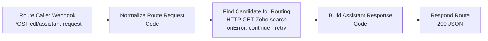
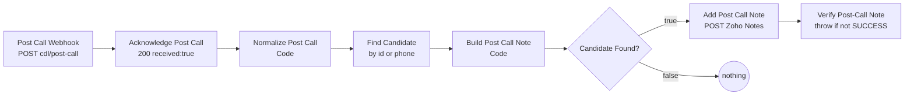

# U2 — n8n basics, on the two small workflows

> **Goal:** read any n8n workflow and explain each node — using the two
> smallest ones: **01 Assistant Routing** (5 nodes) and **04 Post-Call
> Report** (8 nodes).
> Source: `config/n8n/production/modular/cdl-01-assistant-routing.json`,
> `cdl-04-post-call-report.json`. Open them in the n8n UI side by side with
> this doc.

## Five n8n ideas you need first

1. **Webhook node** — gives the workflow a URL. `POST
   https://n8n.accelentai.com/webhook/cdl/assistant-request` starts workflow
   01. The incoming HTTP request becomes the first **item**:
   `{ headers, params, query, body }`. VAPI's data is in `body.message`.
2. **Items** — everything flowing between nodes is a list of JSON objects
   ("items"). Almost every node here passes exactly one item.
3. **Expressions `{{ … }}`** — little JavaScript snippets inside a node's
   settings. `$json` = the current item. `$('Node Name').first().json` = the
   output of an *earlier* node, by name. Rename a node and every expression
   pointing at it breaks — a classic n8n bug.
4. **Code node** — arbitrary JavaScript. Must `return [{ json: {...} }]`
   (a list of items). Your Python mental model: a function that receives a dict
   and returns a list of dicts.
5. **Respond to Webhook** — with `responseMode: "responseNode"`, the caller
   (VAPI) waits until a "Respond to Webhook" node runs. Where you *put* that
   node decides whether work happens **before** or **after** replying.

JavaScript ↔ Python cheat sheet for reading Code nodes:

| JavaScript | Python equivalent |
|---|---|
| `const x = 5` | `x = 5` (can't be reassigned) |
| `a?.b?.c` | `a.get("b", {}).get("c")` — no crash if missing |
| `a ?? b` | `a if a is not None else b` |
| `` `Hi ${name}` `` | `f"Hi {name}"` |
| `[a, b].filter(Boolean).join(' ')` | `" ".join(x for x in [a, b] if x)` |
| `Array.isArray(x) ? x[0] : null` | `x[0] if isinstance(x, list) else None` |

## Workflow 01 — Assistant Routing

| # | Node | What it does | Why it's built this way |
|---|---|---|---|
| 1 | **Route Caller Webhook** | Receives VAPI's `assistant-request`. `responseMode: responseNode` → VAPI waits for node 5. | VAPI can't start talking until it knows which assistant to use, so this must be fast (10 s Zoho timeout). |
| 2 | **Normalize Route Request** | Reads `message.call.customer.number`, runs `normalizePhone()` → `+19185550142`. Outputs `{phone, valid}`. | Zoho stores phones in E.164; searching with `(918) 555-0142` would miss. The top of this node is the whole `cdl_helpers.js` library pasted in (U7 explains why). |
| 3 | **Find Candidate for Routing** | `GET /recruit/v2/Candidates/search?phone=…&per_page=1`, using the saved Zoho OAuth credential. | **`onError: continueRegularOutput`** — if Zoho errors, the workflow does *not* stop; the error goes to node 4 as data. **`retryOnFail`** retries transient failures. |
| 4 | **Build Assistant Response** | If Zoho returned a candidate with an id → Existing Lead assistant + their name as a variable; otherwise New Lead. | This is the **fail-open**: an error has no `data[0].id`, so it falls into "new". |
| 5 | **Respond Route** | Returns `{assistantId, assistantOverrides.variableValues{phoneNumber,name}}`. | `variableValues.name` fills `{{ name }}` in the Existing Lead's first message. |

**Smell to notice:** node 3 searches for `'+10000000000'` when the phone is
empty — a placeholder so the HTTP call doesn't fail. It works, but it's a
workaround instead of a proper "skip the search" branch. Note it in
improvements.

## Workflow 04 — Post-Call Report

| # | Node | What it does |
|---|---|---|
| 1 | **Post Call Webhook** | Receives the `end-of-call-report`. |
| 2 | **Acknowledge Post Call** | Replies `200 {received:true}` **immediately** — before any work. |
| 3 | **Normalize Post Call** | Pulls phone, call ID, transcript (capped at 28,000 chars), summary, cost, and VAPI's `analysis.structuredData` (city/state/ZIP/readiness/experience). Also digs the `candidateId` out of the earlier `logApplicantInfo` tool result inside `artifact.messages`. |
| 4 | **Find Candidate** | If we know the candidate id → `GET /Candidates/{id}`; else search by phone. |
| 5 | **Build Post Call Note** | Formats a human-readable note: call id, cost breakdown, snapshot, **postcode analysis** (ZIP prefix), summary, transcript. Capped at 31,900 chars (Zoho's Note limit). |
| 6 | **Candidate Found?** | IF node. Only the **true** output is connected. |
| 7 | **Add Post Call Note** | `POST /recruit/v2/Notes` with `Parent_Id` = candidate id. |
| 8 | **Verify Post-Call Note** | Throws an error if Zoho didn't say `SUCCESS`, so the execution is marked **failed** and appears in n8n's execution list. |

### The design trade-off in node 2 (important)

Replying first is right for VAPI (it doesn't need anything back, and holding
the connection risks a VAPI timeout). **But** once n8n has said 200, VAPI
considers the report delivered and will never resend it. If Zoho is down at
node 7, the transcript exists only inside a failed n8n execution. There is no
queue, no retry later, no alert. That's the gap the Python API closes with a
durable database write *before* replying.

### Why "Verify" nodes throw on purpose

Node 7 has `onError: continueRegularOutput`, so a Zoho failure would otherwise
look like success. Node 8 converts it back into a real failure. The workflow
settings are `saveDataErrorExecution: all`, `saveDataSuccessExecution: none`
→ **only failed runs are kept**. So throwing = "leave evidence for debugging".

## Reading real executions (do this in the UI)

1. n8n → **CDL 04 - Post-Call Report** → *Executions* tab.
2. Because successful runs aren't saved, you'll only see failures (e.g. the
   historical executions 26–52 mentioned in `docs/PRODUCTION-WORKFLOW.md`).
3. Click one → click each node → compare *Input* and *Output*. Find the first
   node whose output looks wrong. That's the debugging loop you'll use forever:
   **follow the data until it stops looking right.**

## Break it & fix it (on a copy — never the live workflow)

1. In n8n, duplicate **CDL 01 - Assistant Routing** (it stays inactive).
2. Rename node **Normalize Route Request** to `Normalize`.
3. Open the webhook node → *Edit output* (pin data) → paste
   `{"body":{"message":{"call":{"customer":{"number":"(918) 555-0142"}}}}}`
   → save, then click *Test workflow*. (Pinned data lets you replay a request
   without anyone calling.)
4. Question: which node errors, and why? What's the smallest fix?
   (Answer at the bottom — try first.)
5. Delete the copy afterwards.

## Interview questions

**Q: How do you handle errors in n8n?**
A: Per node: `retryOnFail` for transient HTTP failures, and
`onError: continueRegularOutput` so an API error becomes data I can branch on
instead of killing the run — that's how routing fails open. Then explicit
"verify" Code nodes throw when the API didn't return SUCCESS, so real failures
are recorded as failed executions.

**Q: Why respond to the webhook before doing the work in the post-call flow?**
A: VAPI doesn't need a result there, and a fast 200 avoids timeouts and
retries. The trade-off is that after the 200 nothing retries the work, so a
CRM outage loses the note — which is why I moved that path to a Python service
that commits to Postgres before acknowledging.

**Q: What's the difference between `$json` and `$('Node').first().json`?**
A: `$json` is the item coming into the current node; `$('Node')` reaches back
to the output of a named earlier node — useful after an HTTP node replaced the
data, but it couples nodes by name.

---
*Break-it answer:* **Find Candidate for Routing** and **Build Assistant
Response** both reference `$('Normalize Route Request')`, which no longer
exists → "referenced node doesn't exist". Fix: update the expressions (or
rename it back). Lesson: n8n node names are part of your code.
