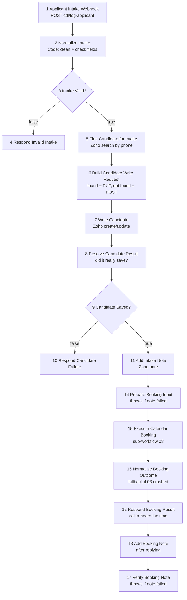

# U3 — Applicant Intake (workflow 02, 17 nodes)

> **Goal:** explain, node by node, what happens in the middle of a live call
> when the AI calls `logApplicantInfo` — and, most importantly, **what the
> caller hears when something goes wrong.**
> Source: `config/n8n/production/modular/cdl-02-applicant-intake.json`
> Built from: `scripts/build_modular_workflows.py` (`build_intake`).

## Why this workflow matters most

This is the only workflow where **a real person is waiting on the phone** while
it runs. Routing (01) also has a waiting caller, but it only reads. Intake
*writes* to Zoho and books the calendar. If it is slow, silent, or crashes, the
caller hears it.

So the one rule to remember: **VAPI must always get an answer.**
"Always" means one of three answers, and one of them is a polite failure:

| Answer VAPI gets | Meaning | Which node sends it |
|---|---|---|
| `invalid_request` | "I need to confirm a few details" (something was missing) | Respond Invalid Intake |
| `manual_followup` (saved: false) | "A recruiter will follow up manually" (Zoho failed) | Respond Candidate Failure |
| `booked` or `manual_followup` (saved: true) | Real result, with the time to read back | Respond Booking Result |

## Five new ideas

1. **IF node** — a fork in the road. It looks at one true/false value and
   sends the item down the **true** output (top) or **false** output (bottom).
   Here it checks a flag that an earlier Code node set (`valid`,
   `candidateSaved`). Pattern: *a Code node decides, the IF node only routes.*
2. **`onError: continueRegularOutput`** (you met this in U2) — if the node
   fails, don't stop the run. The error becomes ordinary data
   (`{ error: ... }`) that the next node can check.
   A node **without** this setting stops the whole run when it fails.
   Keep this contrast in your head, it is the key to W6 below.
3. **`retryOnFail` + `maxTries`** — if the call fails, n8n tries again by
   itself. Here: up to 3 tries, 1 second apart, each try allowed 10 seconds.
4. **Sub-workflow** — the *Execute Calendar Booking* node runs workflow 03 the
   way a function call runs a function. It has no URL of its own. This node
   has `onError: continueRegularOutput` too, so if 03 crashes the intake keeps
   going.
5. **Upsert** ("update or insert") — look up the driver by phone. Found →
   update (`PUT`). Not found → create (`POST`). Node 6 decides which.

## The flow



The numbers are the order in the JSON file, not the order of execution.

## Node by node

| # | Node | What it does | Why it is built this way |
|---|---|---|---|
| 1 | **Applicant Intake Webhook** | Receives VAPI's tool call. `responseMode: responseNode`, so VAPI waits until a Respond node runs. | Same trick as U2. |
| 2 | **Normalize Intake** | Pulls the tool arguments out of `message.toolCalls[0]`, cleans the phone into E.164, splits the name, parses experience into a number, classifies temperature, and builds a list of `validationErrors`. Sets `valid = (no errors)`. | One place decides "is this usable?". The `cdl_helpers.js` library is pasted at the top of the node (U5 and U7 explain why). |
| 3 | **Intake Valid?** | Forks on `valid`. | Keeps the decision (Code) apart from the routing (IF). |
| 4 | **Respond Invalid Intake** | Replies HTTP 200 with `status: invalid_request` and the `missing` list. | The AI reads `missing` and asks the caller again. **HTTP 200 on purpose**: it is a normal, expected answer, not a crash. |
| 5 | **Find Candidate for Intake** | Zoho search by phone. 3 tries, 10 s timeout, `onError: continue`. | Look before you write, so a returning driver is updated, not duplicated. |
| 6 | **Build Candidate Write Request** | Reads the search result. If it holds an id → `PUT /Candidates/{id}`. Otherwise `POST /Candidates`. Builds the body (`Last_Name`, `Phone`, `City`, `State`, `Zip_Code`, `Experience_in_Years`, `Source`). | One Write node can serve both cases because the method and URL are data. |
| 7 | **Write Candidate** | Sends that request to Zoho. Same retry and `onError: continue`. | Failure becomes data, not a crash. |
| 8 | **Resolve Candidate Result** | Decides `candidateSaved` = "we have a candidate id **and** Zoho said SUCCESS". Builds the intake note text. | Do not trust "no error". Check for the positive proof. |
| 9 | **Candidate Saved?** | Forks on `candidateSaved`. | |
| 10 | **Respond Candidate Failure** | `status: manual_followup, saved: false`. | The graceful fallback when Zoho is down. |
| 11 | **Add Intake Note** | Adds a "VAPI Intake" note to the candidate. | The note is the human-readable record for the recruiter. |
| 14 | **Prepare Booking Input** | Checks the note succeeded. If not, **throws**. If yes, hands the saved-candidate data to the booking step. | A Code node used as a guard. See W6. |
| 15 | **Execute Calendar Booking** | Runs workflow 03 and waits for its answer. | Sub-workflow (U4 covers what is inside). |
| 16 | **Normalize Booking Outcome** | If 03 gave a proper answer, pass it on. If it crashed or returned junk → build a `manual_followup` message: "Your application was saved, but the calendar could not be confirmed." | This is a **safety net**: the caller still gets an honest answer. |
| 12 | **Respond Booking Result** | Replies with the confirmed time (or the fallback message). | **The moment the caller hears the result.** |
| 13 | **Add Booking Note** | Writes a "Callback" note. Runs **after** the reply. | Slow bookkeeping never delays the caller (U1). |
| 17 | **Verify Booking Note** | Throws if that note failed. | The caller is already answered, so the only job left is "leave evidence": a failed execution appears in n8n's list (U2). |

## Try it yourself — "who answers VAPI?"

Predict the answer **before** reading the right-hand column.

| Situation | Which Respond node answers? |
|---|---|
| Caller never gave a ZIP code | 4 Respond Invalid Intake (`missing_zip_code`) |
| Zoho is down when we try to save the candidate | 10 Respond Candidate Failure |
| Candidate saved, but workflow 03 (calendar) crashes | 12 Respond Booking Result, with the fallback text from node 16 |
| Candidate saved, calendar booked, then the *booking note* fails | 12 already answered. Node 17 marks the run failed. Caller is unaffected. |
| Candidate saved, but the *intake note* (node 11) fails | **None.** See W6. |

## W6 — confirmed in part

**The claim (from the U2 reading):** if the intake note fails, *Prepare Booking
Input* throws, and no Respond node ever runs.

What I checked, and what is still open:

| Question | Result | How I know |
|---|---|---|
| Does *Prepare Booking Input* have a safety setting (`onError`)? | **No.** Its `onError` is unset. | Read in the JSON. |
| Does its code throw when the note failed? | **Yes**, for both a failed call and a "Zoho said not SUCCESS" reply. | I ran the exact code in Node with fake inputs (no network). Result: `intake_note_write_failed: …` |
| Is any Respond node reachable after the throw? | **No.** In the connections list, the only Respond nodes come from the IF forks (4, 10) and from node 16. | Read the connections. |
| What does n8n send back to VAPI when a run dies this way? | **Not yet proven.** Expected: an HTTP 500 with no `results`, which VAPI treats as a tool error. | This is your exercise below. |
| What does the caller then hear? | **Not proven**, depends on VAPI and the prompt. | Can only be seen in a real call. |

**Impact if it holds:** the driver *was* saved to Zoho (node 7 succeeded), but
the caller hears an error, and the calendar is never booked. The recruiter sees
a candidate with no callback.

**Why it is a nasty one:** the workflow already has the right safety net for
booking (node 16). Only this one guard was left without one.

## Two more weaknesses found while reading (added to improvements.md)

- **W9 — timing.** Each Zoho call can take up to 3 tries × 10 s + 2 s of waiting
  = **32 s**. Intake makes three Zoho calls *before* it replies. VAPI waits
  **30 s** (`timeoutSeconds` in `config/vapi/tool.logApplicantInfo.json`). If
  Zoho is *slow* (not down), VAPI gives up while n8n is still working, and n8n
  may still finish writing.
- **W10 — a failed search looks like "not found".** If the search in node 5
  errors, node 6 sees no `data`, picks `POST`, and creates a **new** candidate.
  A temporary search failure can create a duplicate for a returning driver.

## Break it & fix it — confirm W6 yourself (on a copy)

Rules: only on the n8n copy where **every workflow is inactive**. Never on the
one serving real calls. Nothing here touches Zoho, because the three Zoho nodes
will use pinned (fake) data.

1. In n8n, open **CDL 02 - Applicant Intake** → menu `⋯` → **Duplicate**.
   Open the copy. The rest of this exercise happens **only in the copy**.
2. For each of these three nodes, open it, and in the output panel choose
   **Set mock data** (or the pin icon), then paste:
   - **Find Candidate for Intake** → `{"data": []}`
     (pretend: "not found").
   - **Write Candidate** → `{"data":[{"code":"SUCCESS","details":{"id":"CAND-1"}}]}`
     (pretend: "saved").
   - **Add Intake Note** → `{"error":{"message":"Bad gateway"}}`
     (pretend: "Zoho failed on the note").
3. Click **Listen for test event** on the webhook node. It shows a *test URL*
   that ends in `/webhook-test/cdl/log-applicant`.
4. In PowerShell, from the repo folder, send the sample call (fictional Dana):

   ```powershell
   curl.exe -i -X POST "<TEST URL from step 3>" -H "Content-Type: application/json" --data "@docs/learning/existing/samples/u3-dana-intake.json"
   ```

   (Use `curl.exe`, not `curl`. In PowerShell 5.1, plain `curl` is a different
   command with different options.)
5. Write down: **(a)** the HTTP status line, **(b)** the response body,
   **(c)** which node is red in the n8n canvas.
6. **Your questions to answer:**
   - What status and body did VAPI's side get?
   - What is the smallest fix? (Two candidates: give node 14 `onError:
     continueRegularOutput` and route the error to a Respond node; or treat a
     failed *note* as non-fatal, because the candidate is saved and the note
     is only a nice-to-have.) Which would you choose, and why?
7. Delete the copy when you are done.

Bring me the three values from step 5 and we will mark W6 **confirmed** or
**refuted** in `improvements.md`. I have not made any changes to n8n or VAPI.

## Interview questions

**Q: What happens if Zoho fails while a driver is on the phone?**
A: Intake never leaves the caller in silence. Each Zoho call retries, and if it
still fails the error is turned into data, so a check node routes to a
"recruiter will follow up manually" reply. VAPI always gets a valid answer.
The honest gap is that those details are not stored anywhere durable, which is
why I added a database.

**Q: Why does an IF node come after a Code node instead of doing the check
itself?**
A: The Code node can do real logic (clean the phone, list all the problems).
The IF node then only reads one true/false flag. It keeps the branching easy to
see on the canvas.

**Q: Where does this workflow have a weak spot?**
A: A guard node after the intake note throws without a fallback, so a failed
note ends the run before any reply. The driver is saved but the caller may hear
an error. I found it by reading the connections, proved the throw locally, and
would fix it by making a failed note non-fatal.

**Q: What does "retry" buy you, and what does it cost?**
A: It hides short glitches. The cost is time: three tries of ten seconds can
outlast VAPI's 30-second wait, so retries need to fit inside the caller's
time budget.

## Glossary added
IF node · retryOnFail · timeout · upsert · guard node · tool-call ID ·
graceful fallback
