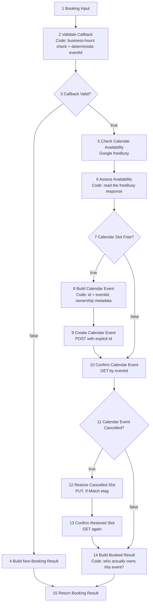

# U4 — Calendar Booking (workflow 03, 15 nodes)

> **Goal:** understand how this sub-workflow books a 15-minute callback slot
> without ever double-booking it, even when VAPI delivers the same tool call
> twice or two different callers want the exact same time.
> Source: `config/n8n/production/modular/cdl-03-calendar-booking.json`
> Built from: `scripts/build_modular_workflows.py` (`build_calendar_booking`).

## Why it matters most

Intake (U3) only ever *calls* this workflow once, through "Execute Calendar
Booking," and trusts whatever comes back. This is where the actual booking
decision — and the actual race condition — happens. Two problems it has to
solve at the same time:

1. **Idempotency** — if the same tool call arrives twice (a VAPI retry, a
   flaky connection), booking it twice must not create two calendar events.
2. **Concurrency** — if *two different* candidates ask for the exact same
   15-minute slot at nearly the same moment, exactly one of them should get
   it, and the other should hear "that time is taken," not silently overwrite
   the first.

Neither problem shows up in a single manual test run. Both only appear when
you deliberately force the timing — that's what this doc's exercise does.

## Five new ideas

1. **`executeWorkflowTrigger` with `inputSource: passthrough`** — the trigger
   node a sub-workflow starts with. `passthrough` means "accept whatever JSON
   the caller sent, unchanged," instead of forcing a fixed input schema. This
   is the receiving end of the same call U3 made from "Execute Calendar
   Booking."
2. **Deterministic ID (idempotency key)** — instead of letting Google
   Calendar invent a random event ID, node 2 *computes* the ID from the
   requested time itself (`cdlslot` + the start time in seconds, base-32
   encoded). Same requested time → same ID, every time. That's what makes a
   duplicate delivery safe: the second attempt tries to create the exact same
   ID instead of a new one.
3. **Tombstone** — Google Calendar doesn't fully forget a deleted event
   immediately; for a while, its ID still exists with `status: "cancelled"`.
   If a deterministic ID happens to match an old, cancelled event, the
   workflow can *find* it (node 11) instead of getting a clean "not found."
4. **ETag + `If-Match` (optimistic concurrency)** — a lightweight way to avoid
   two writers stepping on each other *without* using a real lock. Every time
   you read a record, Google hands you an `etag` (a fingerprint of its current
   state). When you write it back, you attach `If-Match: <that etag>`. If
   someone else changed the record in between, the etag no longer matches and
   the write is rejected — instead of silently overwriting their change.
5. **`extendedProperties.private`** — hidden metadata you can attach to a
   calendar event, invisible in the normal calendar UI but readable through
   the API. Here it stores `vapiCallId` — proof of *which call* created this
   event, used later to answer "does this slot belong to me?"

## The flow



Node numbers here match the JSON's node order (unlike U3, execution order
mostly follows it too).

## Node by node

| # | Node | What it does | Why it is built this way |
|---|---|---|---|
| 1 | **Booking Input** | Receives whatever "Execute Calendar Booking" (U3, node 15) sent, unchanged. | `passthrough` trigger — no schema to keep in sync with the caller. |
| 2 | **Validate Callback** | Same `cdl_helpers.js` library pasted in (you'll read the real source in U5). Checks the requested time against business hours *and* a hand-built US federal holiday calendar. If valid, computes the deterministic `eventId`. | One function (`validateCallback`) is the single source of truth for "is this a bookable time," reused wherever it's needed. |
| 3 | **Callback Valid?** | Forks on `callbackValid`. | |
| 4 | **Build Non-Booking Result** | Friendly message: pick a weekday between 9 AM–5 PM Pacific. | Same "graceful fallback" pattern from U3. |
| 5 | **Check Calendar Availability** | Asks Google's `freeBusy` API: is `toshiki@accelentai.com`'s calendar free in this exact 15-minute window? 3 tries, 10 s timeout, `onError: continue`. | Same retry template you already know from U3 (and questioned — good, keep questioning it here too). |
| 6 | **Assess Availability** | Reads the response. Sets `calendarAvailable = true` only if there was no API error *and* the `busy` list is empty. | Don't trust "no error" alone — check for the positive proof, same lesson as U3's node 8. |
| 7 | **Calendar Slot Free?** | Forks on `calendarAvailable`. | |
| 8 | **Build Calendar Event** | Builds the event body: explicit `id: eventId` (the deterministic ID from node 2), summary/description with candidate details, and `extendedProperties.private.vapiCallId` + `zohoCandidateId` — the ownership proof. | Setting the ID explicitly, instead of letting Google generate one, is what turns "create" into "create-or-already-exists" — the idempotency mechanism. |
| 9 | **Create Calendar Event** | `POST .../events` with that explicit ID. `onError: continue`. | If this exact ID already exists (a retried call, or a real race), Google rejects the insert — but the workflow doesn't stop, because the *next* node re-reads the truth regardless. |
| 10 | **Confirm Calendar Event** | `GET` the event by `eventId` — independent of whether node 9 just succeeded, failed, or was skipped entirely (the `false` branch of node 7 jumps straight here). | Always re-read the actual server state instead of trusting what you *think* just happened. This one GET serves three different histories. |
| 11 | **Calendar Event Cancelled?** | Checks `status === 'cancelled' && etag exists` — the tombstone case. | |
| 12 | **Restore Cancelled Slot** | `PUT` the same event body back with `status: 'confirmed'`, guarded by `If-Match: <etag>`. | Resurrects a tombstoned slot for reuse — but only if nobody else changed it since we read it (optimistic concurrency, idea 4 above). |
| 13 | **Confirm Restored Slot** | `GET` again, to see whether the restore actually landed. | If the `If-Match` was rejected (someone else got there first), this GET shows the real outcome instead of assuming the PUT worked. |
| 14 | **Build Booked Result** | The real decision node. Checks: does the fetched event exist, match `eventId`, and *not* say cancelled (`eventMatches`)? Does its `vapiCallId` match **this** call's `callId` (`ownedByCall`)? Only `ownedByCall` becomes `status: 'booked'`. Otherwise: `slot_unavailable` (someone else's event) or `manual_followup` (a real calendar failure). | Existence isn't proof of ownership. Two different calls can both "find" the same event at this ID — only the metadata check tells them apart. |
| 15 | **Return Booking Result** | `return $input.all();` — plain pass-through back to U3's "Execute Calendar Booking." | Same trivial pattern as U3's node 17: its only job is to hand the finished object back up. |

## Try it yourself — predict the outcome

| Situation | What happens |
|---|---|
| Caller asks for a Saturday | Node 4 — `slot_unavailable`, told to pick a weekday |
| VAPI delivers the *same* tool call twice, same slot | 2nd attempt's `Create Calendar Event` likely fails (ID exists) — harmless, because node 10 re-reads and node 14 sees `ownedByCall: true` either way → `booked` both times |
| Two *different* candidates ask for the exact same slot | Whoever's `Create Calendar Event` lands first wins. The second one's node 14 sees `eventMatches: true` but `eventOwner !== their callId` → `ownedByCall: false` → `slot_unavailable`, `bookingReason: slot_race_lost` |
| That slot was booked once before, then the event was deleted, and someone requests the same time again | Node 10's GET finds the tombstone (`status: cancelled`) → node 12 resurrects it → node 14 checks ownership of the *restored* event |
| Google Calendar API is down | Retries exhaust, `calendarError` paths trigger → eventually `manual_followup`, same honest-fallback idea as U3 |

## Break it & fix it — force the race yourself (on a copy)

Rules: only on the n8n copy where every workflow is inactive. Nothing here
touches the real Google Calendar, because the two Google nodes you'll touch
use pinned (fake) data.

1. Duplicate **CDL 03 - Calendar Booking**. Work only in the copy.
2. Pin **Confirm Calendar Event**'s output to simulate "this slot already
   belongs to someone else":
   ```json
   {
     "id": "cdlslot1lbda4g",
     "etag": "\"abc123\"",
     "status": "confirmed",
     "htmlLink": "https://www.google.com/calendar/event?eid=fake",
     "extendedProperties": { "private": { "vapiCallId": "call-SOMEONE-ELSE" } }
   }
   ```
3. Pin **Assess Availability**'s output so the run reaches this point with a
   *different* `callId` than `call-SOMEONE-ELSE` — e.g. add
   `"callId": "call-YOU-0001"` to its pinned data.
4. Run the workflow manually from the trigger (or via the intake exercise
   from U3, if you still have that copy).
5. Check **Build Booked Result**'s output.
   - What is `status`? What is `bookingReason`?
   - Does `callerMessage` correctly tell the caller the slot is taken, rather
     than falsely confirming a booking that belongs to someone else?
6. Now flip it: set `vapiCallId` in step 2 to match your `callId` from step 3.
   Re-run. Confirm `status` becomes `booked`. This is the "my own retry"
   case — same event, but now it's genuinely yours.
7. Delete the copy when done.

Bring me what you saw in step 5 and 6, and we'll note whether the ownership
check actually behaves the way node 14's code claims.

## Review questions

**Q: How does this workflow avoid double-booking the same slot when VAPI
retries a tool call?**
A: I don't let Google assign a random ID — I calculate the event ID from the
time slot itself. So a retry always targets the same ID instead of creating a
new one, and I always re-read the event afterward instead of trusting that my
own request succeeded.

**Q: Two candidates want the same 15-minute slot at the same moment. What
actually decides who gets it?**
A: Whoever's request reaches Google first wins the ID — that's just normal
server behavior. The loser then sees an event that exists but isn't theirs,
because I stamp ownership metadata on every event. So they get told the slot's
taken instead of a false "you're booked."

**Q: What does `If-Match` with an ETag actually protect against, and why not
just use a database lock?**
A: It only matters for one case — restoring a cancelled slot. If two requests
try to restore it at once, the ETag is a fingerprint of the event's
last-known state; if it's stale, Google rejects the write. A real lock would
mean I own where it lives and how it gets released if something crashes —
this way the server just handles it for me.

## Glossary added
Deterministic ID · Tombstone · ETag / `If-Match` (optimistic concurrency) ·
`extendedProperties.private` · Sub-workflow trigger / passthrough
